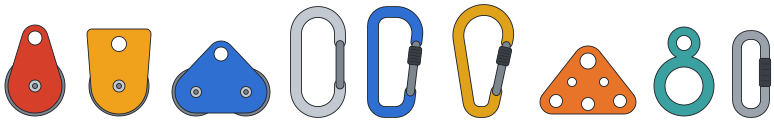

# vRigger Object Library

A library of rope-rigging equipment drawn as clean vector graphics, for use in
**vRigger** (rope rigging systems on your computer). Pick the objects you want,
choose **SVG**, **EPS** or both, and save them to any folder.



## Objects

| Category | Objects |
|---|---|
| Pulleys | Single pulley · Prusik-minding pulley · Double pulley (tandem) |
| Carabiners | Oval carabiner · D carabiner (screwgate) · HMS carabiner (pear) |
| Hardware | Rigging plate · Figure-8 descender · Quick link (maillon) |

All objects are drawn at roughly real size in millimetres, so they keep the
right size relative to each other. Each one comes in two styles:
**Color** and **Mono** (black outline on white, good for printing).

## Requirements

Python 3.10 or newer. Nothing else is needed: the SVG and EPS files are written
directly, without Inkscape or Ghostscript. The window uses Tkinter, which is
included with Python on Windows and macOS. On Linux you may need to install it,
for example with `sudo apt install python3-tk`.

## Using the program

```bash
python run_library.py
```

1. Tick the objects you want in the list on the left. Point at an object to
   preview it.
2. Choose the format (SVG, EPS or both), the style, and the scale
   (1 = real size).
3. Pick a destination folder with **Browse…** and press **Export**.

Files are named after the object, for example `pulley_single.svg` or
`carabiner_hms.eps`. If you tick **Don't overwrite existing files**, the
program adds a number to the name instead of replacing an existing file.

### Command line

```bash
python -m vrigger_library list
python -m vrigger_library export pulley_single carabiner_oval -f svg eps -o ~/rigging
python -m vrigger_library export --all -f eps -p mono -s 2 -o ./out
```

## Adding objects

Objects live in `vrigger_library/catalog.py`. Each one is a short function that
builds a drawing out of paths, circles and rounded polygons, decorated with
`@register(...)`:

```python
@register("my_object", "My object", "Hardware", "What it is.")
def _my_object(pal):
    d = Drawing(40, 40)                       # canvas size in mm
    d.add(circle(20, 20, 15), _solid(pal, pal.metal))
    return d
```

New objects show up automatically in the program and on the command line.
Run `python tools/make_gallery.py` to refresh the gallery image, and
`python -m pytest tests` to check that everything still renders.
